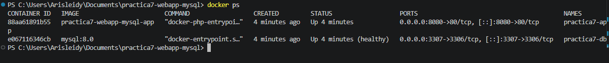
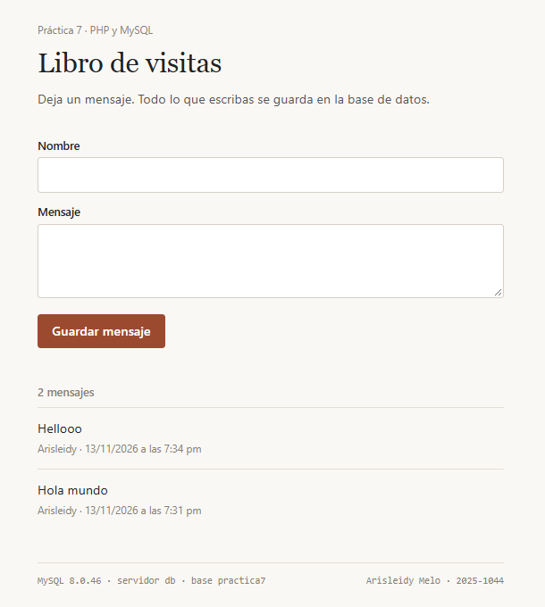

# Práctica 7: Web App con Dockerfile y Docker Compose

Aplicación web en PHP que se conecta a una base de datos MySQL: un libro de visitas sencillo donde se pueden escribir mensajes que quedan guardados en la base de datos. El primer registro guardado es el "Hola mundo". Los dos servicios se ejecutan en contenedores y se levantan juntos con Docker Compose, y la imagen de la aplicación se construye con un `Dockerfile` propio.

## Objetivo

Crear una aplicación web "Hola Mundo" que se conecte a una base de datos MySQL, usando un `Dockerfile` para el servidor de aplicación y un `docker-compose.yml` para ejecutar ambos servicios.

## Tecnologías utilizadas

| Herramienta | Uso |
|---|---|
| PHP 8.2 + Apache | Servidor de aplicación |
| MySQL 8.0 | Base de datos |
| PDO (pdo_mysql) | Conexión de PHP con MySQL |
| Dockerfile | Construcción de la imagen de la aplicación |
| Docker Compose | Definición y ejecución de los servicios |
| HTML y CSS | Interfaz de la página |

## Arquitectura

```
          Navegador
              │
              ▼  http://localhost:8080
 ┌─────────────────────────┐
 │  app (PHP + Apache)     │  ← imagen construida con el Dockerfile
 │  contenedor: practica7-app
 └───────────┬─────────────┘
             │  host: db, puerto 3306
             ▼
 ┌─────────────────────────┐
 │  db (MySQL 8.0)         │  ← datos guardados en el volumen db_data
 │  contenedor: practica7-db
 └─────────────────────────┘
```

Los dos contenedores están en la misma red que crea Docker Compose, por eso la aplicación se conecta a la base de datos usando el nombre del servicio (`db`) como servidor.

## Estructura del proyecto

```
practica7-webapp-mysql/
├── src/                    # Código fuente de la aplicación
│   ├── index.php           # Página principal: lista y guarda mensajes
│   ├── conexion.php        # Conexión a la base de datos con PDO
│   └── estilos.css         # Estilos de la página
├── capturas/               # Evidencias de la ejecución
├── database/
│   └── init.sql            # Crea la tabla y el mensaje "Hola mundo"
├── Dockerfile              # Imagen del servidor de aplicación
├── docker-compose.yml      # Servicios app y db
├── .dockerignore           # Archivos que no se copian a la imagen
└── README.md
```

## Desarrollo de la práctica

### a) Directorio `src` con el código fuente

En la carpeta `src` está la aplicación:

- `conexion.php` lee los datos de conexión desde las variables de entorno definidas en el `docker-compose.yml` y crea la conexión con PDO.
- `index.php` muestra los mensajes guardados en la tabla `mensajes` y tiene un formulario para agregar mensajes nuevos. Los datos se guardan con consultas preparadas (`prepare` y `execute`).
- `estilos.css` le da el diseño a la página.

Además, el archivo `database/init.sql` crea la tabla `mensajes` y guarda el primer registro, "Hola mundo". MySQL lo ejecuta automáticamente la primera vez que se crea el contenedor.

| Columna | Tipo | Descripción |
|---|---|---|
| `id` | INT | Identificador automático |
| `nombre` | VARCHAR(50) | Quién escribió el mensaje |
| `texto` | VARCHAR(255) | Contenido del mensaje |
| `creado_en` | TIMESTAMP | Fecha y hora en que se guardó |

### b) Archivo `docker-compose.yml`

Define los dos servicios de la aplicación, sus variables de entorno, puertos y volúmenes:

```yaml
services:
  app:
    build: .
    container_name: practica7-app
    ports:
      - "8080:80"
    environment:
      DB_HOST: db
      DB_NAME: practica7
      DB_USER: usuario
      DB_PASSWORD: usuario123
    volumes:
      - ./src:/var/www/html
    depends_on:
      db:
        condition: service_healthy
    restart: unless-stopped

  db:
    image: mysql:8.0
    container_name: practica7-db
    environment:
      MYSQL_ROOT_PASSWORD: root123
      MYSQL_DATABASE: practica7
      MYSQL_USER: usuario
      MYSQL_PASSWORD: usuario123
    ports:
      - "3307:3306"
    volumes:
      - db_data:/var/lib/mysql
      - ./database/init.sql:/docker-entrypoint-initdb.d/init.sql
    healthcheck:
      test: ["CMD", "mysqladmin", "ping", "-h", "localhost", "-u", "root", "-proot123"]
      interval: 5s
      timeout: 5s
      retries: 10
    restart: unless-stopped

volumes:
  db_data:
```

### c) Servicio del servidor de aplicación (PHP)

El servicio `app` se construye a partir del `Dockerfile`:

```dockerfile
FROM php:8.2-apache
RUN docker-php-ext-install pdo pdo_mysql
COPY src/ /var/www/html/
EXPOSE 80
```

| Parámetro | Descripción |
|---|---|
| `build: .` | Construye la imagen usando el `Dockerfile` del proyecto |
| `ports: "8080:80"` | La aplicación se abre en el puerto 8080 de la PC |
| `environment` | Datos de conexión que usa `conexion.php` |
| `volumes: ./src` | Los cambios en el código se ven sin reconstruir la imagen |
| `depends_on` | La aplicación espera a que MySQL esté listo antes de iniciar |

### d) Servicio de base de datos (MySQL)

| Parámetro | Descripción |
|---|---|
| `image: mysql:8.0` | Imagen oficial de MySQL |
| `MYSQL_DATABASE` | Crea la base de datos `practica7` |
| `MYSQL_USER` / `MYSQL_PASSWORD` | Usuario que usa la aplicación para conectarse |
| `ports: "3307:3306"` | Permite entrar a MySQL desde la PC por el puerto 3307 |
| `db_data` | Volumen donde se guardan los datos aunque se apague el contenedor |
| `init.sql` | Script que crea la tabla y el primer mensaje |
| `healthcheck` | Comprueba que MySQL ya esté aceptando conexiones |

## Resultado

Contenedores en ejecución después de `docker compose up -d --build`. La base de datos aparece como `healthy`:



Aplicación funcionando en `http://localhost:8080`. El mensaje "Hola mundo" viene de la base de datos y el segundo mensaje se guardó desde el formulario:



## Cómo ejecutarlo

1. Tener Docker Desktop instalado y abierto.
2. Clonar el repositorio:

   ```bash
   git clone https://github.com/Arisleidy-03/practica7-webapp-mysql.git
   cd practica7-webapp-mysql
   ```

3. Construir la imagen y levantar los servicios:

   ```bash
   docker compose up -d --build
   ```

4. Comprobar que los dos contenedores están corriendo:

   ```bash
   docker ps
   ```

5. Abrir en el navegador:

   ```
   http://localhost:8080
   ```

## Comandos útiles

| Comando | Descripción |
|---|---|
| `docker compose up -d --build` | Construye la imagen y levanta los servicios |
| `docker ps` | Muestra los contenedores en ejecución |
| `docker compose logs app` | Muestra los registros de la aplicación |
| `docker compose logs db` | Muestra los registros de MySQL |
| `docker exec -it practica7-db mysql -u usuario -pusuario123 practica7` | Entra a la base de datos desde la terminal |
| `docker compose down` | Detiene y elimina los contenedores |
| `docker compose down -v` | Además borra el volumen de la base de datos |

## Autora

Arisleidy Melo - 2025-1044
